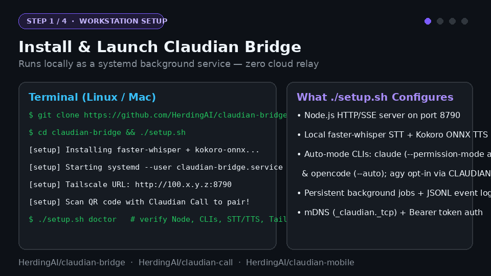
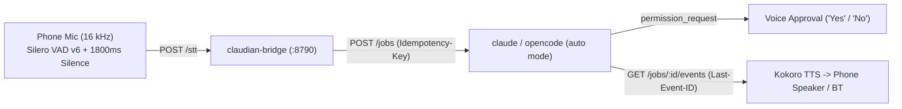

# Claudian Call

Native Android companion app (Kotlin) for **screen-off, phone-call-style** voice conversations with your workstation's `claudian-bridge` over Tailscale or LAN.





## Why This Exists

Android suspends Obsidian's WebView and revokes `getUserMedia()` microphone capture when the screen turns off. **Claudian Call** runs a native Android Foreground Service so you can lock your phone, put it in your pocket or use a Bluetooth headset, and talk to AI hands-free just like a normal phone call.

## User #1 Quick Start (Zero to Running)

1. **Set up `claudian-bridge` on your workstation** (runs as a `systemd --user` background service):
   ```bash
   git clone https://github.com/HerdingAI/claudian-bridge.git
   cd claudian-bridge
   ./setup.sh
   ```
   `./setup.sh` installs `faster-whisper` STT, Kokoro TTS + voice models, starts the bridge with LAN mDNS auto-discovery (`_claudian._tcp.`), and prints a **QR code** (`claudian://pair?...`).

2. **Install Claudian Call on your Android phone**:
   - Download the latest APK (`v0.6.9+`) from **[GitHub Releases](https://github.com/HerdingAI/claudian-call/releases)** (or F-Droid).
   - *Upgrading from an older pre-M1 APK?* Install `v0.6.9` once from GitHub Releases or via `adb install`; `/apk` now requires Bearer auth so older unauthenticated builds cannot self-update from `/apk`.

3. **Pair & Call**:
   - Ensure Tailscale (or the same Wi-Fi LAN) is connected on both phone and PC.
   - Open **Claudian Call** -> **Scan QR Code** (or **Auto-Discover LAN**) -> tap **Pair** on *"Pair with this computer?"*.
   - Grant Microphone, Notifications, and Nearby Devices permissions, then tap **Call** and lock your screen.

## Features

- **Screen-Off Foreground Service** (`microphone | mediaPlayback`): Keeps CPU (`PARTIAL_WAKE_LOCK`), Wi-Fi (`WifiLock`), mic capture, and Tailscale SSE streaming alive with the screen off.
- **2-Layer Noise-Resistant VAD (`SpeechVad.kt`)**:
  - **Layer 1 (DSP)**: `215 Hz – 3.4 kHz` speech-band filter, Zero-Crossing Rate gate (`0.02..0.32`), and adaptive ambient noise floor tracking.
  - **Layer 2 (Neural VAD)**: On-device **Silero VAD v6** (`silero_vad_v6.onnx` via `onnxruntime-android`), 3-frame (~96 ms) speech-onset debouncing, `1800 ms` silence window, `200 ms` min speech, and `bargeIn = false` by default.
- **Non-Interrupting Turn Queue & Persistent Jobs**: Uses `POST /jobs` (`Idempotency-Key`) + `GET /jobs/:id/events` (`Last-Event-ID` replay) and queues follow-up utterances in `pendingTranscripts` while the agent is thinking instead of aborting the active run.
- **Voice Permission Approvals**: Speaks plain-English permission prompts (`AWAITING_APPROVAL`) and routes `"Yes"` / `"No"` / `"Repeat"` via `ApprovalClassifier` to `POST /approvals/:id`.
- **Loud Failures with Android TTS Fallback**: Every failure class (`ErrorSpeech`) speaks aloud even if the bridge or Kokoro TTS is unreachable.
- **Hardware-Backed Security**: Token stored in **AndroidKeyStore** (`AES/GCM/NoPadding`), `allowBackup="false"`, pairing confirmation dialog, private/Tailscale cleartext restriction, and SHA-256 + signing-certificate verification on `/apk` self-updates.
- **Multi-Provider, Workspaces & Dynamic Models**: Switch between **Claude Code** (`claude`) and **OpenCode** (`opencode`) (plus `agy` when `CLAUDIAN_ENABLE_AGY=1`), pick or create project folders (`📁 <workspace> ▾`), hear a 5-second **`↻ Recap`**, and save notes to Obsidian (`Save`).

## Build from Source

Requires full **JDK 17** (with `jlink`, e.g., `~/.gradle/jdks/jdk-17.0.21+9`) and Android SDK (API 34):

```bash
JAVA_HOME=~/.gradle/jdks/jdk-17.0.21+9 ./gradlew assembleFdroidRelease   # F-Droid / FOSS build (no self-updater)
JAVA_HOME=~/.gradle/jdks/jdk-17.0.21+9 ./gradlew assembleDirectDebug     # Direct sideload build (includes /apk self-updater)
```

Current direct build: **`v0.6.10` (`versionCode = 16`)**. Output APKs: `app/build/outputs/apk/fdroid/release/app-fdroid-release-unsigned.apk` and `app/build/outputs/apk/direct/debug/app-direct-debug.apk` (release copy in `dist/claudian-call.apk`).

## Claudian Suite

- **[Claudian Bridge](https://github.com/HerdingAI/claudian-bridge)** — Workstation HTTP/SSE server required by Claudian Call (exposes Claude Code, OpenCode, `faster-whisper` STT, and Kokoro TTS).
- **[Claudian Mobile](https://github.com/HerdingAI/claudian-mobile)** — Mobile-compatible Obsidian plugin for iOS, Android, and Desktop over `claudian-bridge`.
- **[Claudian Voice](https://github.com/HerdingAI/claudian-voice)** — Desktop Obsidian plugin (deprecated/frozen in favor of `claudian-bridge` + `claudian-mobile`).

## License

MIT — see [LICENSE](LICENSE).
